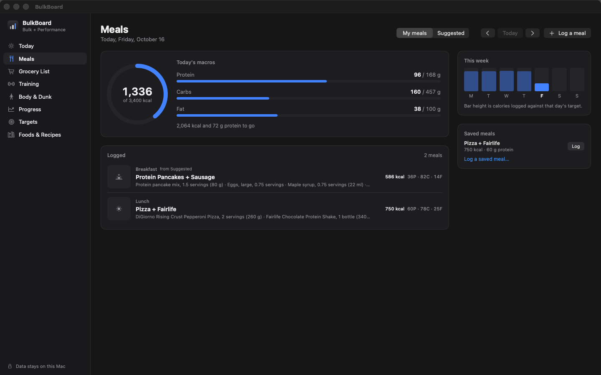
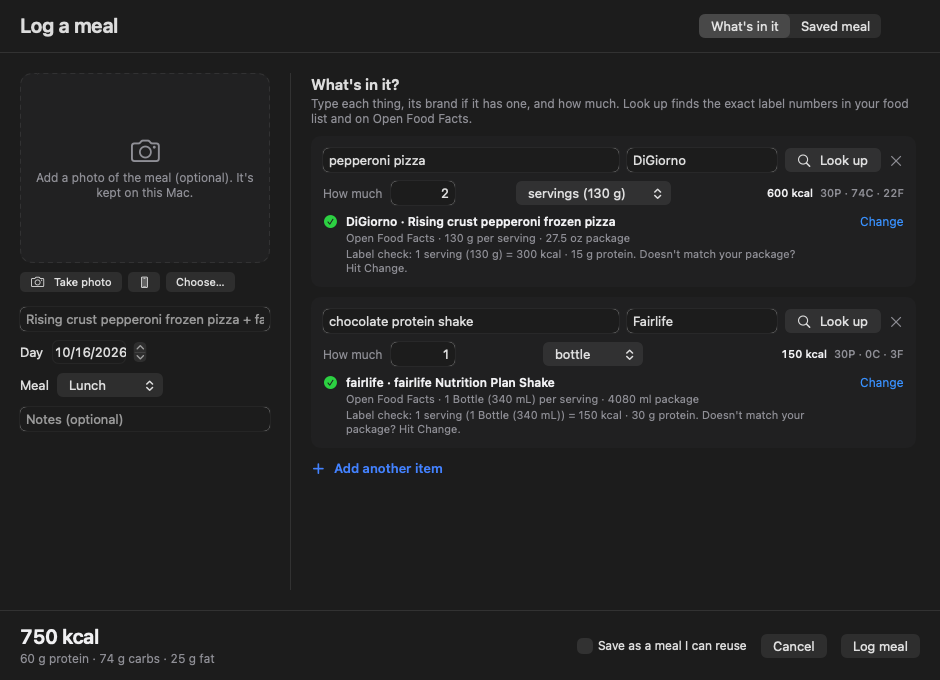
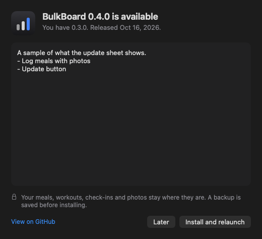

<p align="center">
  
</p>

<h1 align="center">BulkBoard</h1>

<p align="center">
  A local-first Mac app for bulking: macros, meal logging, suggested meals, grocery lists, training, body measurements and progress, in one place. Built for athletes who want to add size without losing their game, dunk included.
</p>

<p align="center">
  <a href="https://github.com/XmanXay69/bulkboard/actions/workflows/ci.yml"></a>
  
  
  
  <a href="LICENSE"></a>
</p>


## What it does

1. **Sets your calorie and macro targets** from your stats and goal, and shows the math.
2. **Logs what you actually eat**: snap a photo, say what's in it, the brand and how much, and BulkBoard finds the exact label numbers.
3. **Suggests a week of meals** that hits your targets when you want ideas, and builds the grocery list from it.
4. **Plans your training week**: a lifting split for a standard gym plus basketball/conditioning days.
5. **Reads your body**: a local AI coach looks at your check-in photo and numbers, says what's behind, and the plan gives it extra work.
6. **Works out what it takes to dunk** from your height, wingspan, reach and vertical, and adds jump training.
7. **Tracks progress**: bodyweight trend, lifts, PRs, adherence and streaks.
8. **Updates itself**: a button lights up when there's a new version on GitHub. One click installs it; your data stays put.

No account, no cloud sync, no analytics. Your data stays on your Mac.

## Features

### Targets that show their work
- Mifflin-St Jeor BMR × activity level for maintenance, then a surplus sized to your target rate of gain (default 0.5–1 lb/week).
- Warns when a goal date is unrealistic, caps the rate, and tells you when you'll actually get there.
- Protein from bodyweight (0.8–1 g/lb), fat as a share of calories (25–30%), carbs fill the rest.
- Separate targets for lift, court and rest days that average out to your weekly target. Override any of them.
- Five goal modes: Bulk, **Bulk + Performance** (default), Recomp, Cut, Maintain.


### Meals: yours first, suggestions when you want them
- **My meals** is what you ate. Nothing appears there until you log it, and only logged meals count toward your day.
- **Log a meal** (⇧⌘E): add a photo if you like (choose one, drop or paste it, take one with the Mac's camera, or use your iPhone through Continuity Camera). Then list what's in it: the product, the brand, and how much (servings, slices, packages, grams or ounces).
- **Look up** searches your food list and [Open Food Facts](https://openfoodfacts.org), a free, open database of packaged foods, and pulls the exact label numbers: per serving, per piece ("1 slice = 28 g"), per package. Type or photograph a barcode for an exact match. Nothing found? Estimate it with the local AI, type the numbers from the label, or search the web.
- **Fill in from photo**: with the local AI, BulkBoard lists what it sees in the meal photo for you to confirm and look up.
- Every match shows a label check ("1 serving (130 g) = 300 kcal") so you can compare it with the package. AI numbers are always marked as estimates.
- Tick **Save as a meal I can reuse** to log it again in one click. Saved meals also feed the suggestions.
- **Suggested** is the auto-planner: a 7-day grid that lands each day on target from 80 built-in foods, 44 meals and your saved meals. Shuffle, lock, drag, set variety from *Meal prep* to *Mix it up*, and log a suggestion with "I ate this". Shakes are shaker-bottle-only.

| My meals | Log a meal |
|---|---|
|  |  |


### Grocery list
- One click builds it from the suggested week. Quantities merge across meals with unit conversion and group by store section.
- Check-off mode, a phone-sized **pop-out window** for the store, manual items, copy or export as plain text.


### Training
- Weekly plan for 0–6 lifting days plus court days, arranged so leg days don't land right before court days.
- Live logger with **previous performance inline**, **progressive overload suggestions** ("Last time 135 × 8 lb. Try 140 today."), a rest timer, and **automatic PR detection** (heaviest weight, best e1RM, rep PRs).
- Log basketball or conditioning sessions with duration and RPE; the load shows up next to lifting volume.
- 58-exercise library for barbells, dumbbells, machines and cables, plus your own custom exercises.

| This week | Logging a session |
|---|---|
|  |  |

### Body & Dunk
- **Check-ins**: height, weight, wingspan, standing reach, wrist and tape measurements, body fat (or a Navy-method estimate), standing vertical and best running touch, plus an optional photo.
- **Proportions**: each part is compared with a classic target scaled to your frame (chest = 6.5 × wrist and fixed shares of that, shoulders ≈ 1.618 × waist for the V-taper). The weakest parts are flagged as focus areas. FFMI shows how much lean mass you have relative to your height.
- **AI coach**: a model running in Ollama on your Mac reviews each check-in by itself (no button to press) using your photo, measurements, goal, training plan and recent meals. It says which muscle groups look behind and what to change in training and food. If your newest check-in has no photo, it uses your most recent one. Nothing is uploaded.
- **Apply to my plan**: focus muscles get extra sets and an accessory on the days that train them, with an optional protein bump. (Food can't target one muscle; the extra training decides where growth shows up.)
- **Dunk**: estimates your standing reach from height and wingspan (fit to NBA combine data), works out the running jump a dunk needs, measures the gap against your numbers, and shows what each 10 lb of bulk costs in vertical at the same power (Sayers equation). One click adds depth jumps, trap-bar jumps, calf and ankle work, and approach jumps on court days, and can cap your gain rate at 0.5 lb/week.

| Physique | Dunk |
|---|---|
|  |  |

### Progress
- Bodyweight with a 7-day moving average and a projection toward your goal date.
- Estimated 1RM per lift, weekly lifting volume, court load, calorie and protein adherence.
- Macro streaks and a weekly summary (this week vs last).


### Local AI that's ready to go
BulkBoard uses [Ollama](https://ollama.com) on your Mac for the AI coach, meal-photo reading, macro estimates and meal ideas. If Ollama is installed, BulkBoard starts it when needed (and stops it on quit). Settings → Local AI downloads the recommended model, `qwen3-vl:4b-instruct` (3.3 GB, reads photos and text), in one click. The AI only talks to `127.0.0.1:11434`: no cloud APIs, no keys. AI numbers are labeled as estimates, and everything else works without it.

### Updates
A button in the top-right corner lights up when GitHub has a newer release. Click it, read what's new, and choose **Install and relaunch**. BulkBoard saves a backup, downloads the release, checks it against GitHub's SHA-256 checksum and its code signature, swaps itself in place and reopens. Running it straight from the disk image? It offers to move itself to Applications first. Updates never touch your data, which lives outside the app.



### Design
Neutral and quiet: system fonts, one accent color, native controls, light and dark mode (follows macOS by default).

| Welcome | Light mode |
|---|---|
|  |  |

## Install

**[⬇ Download BulkBoard for Mac (.dmg)](https://github.com/XmanXay69/bulkboard/releases/latest)**

1. Open the DMG from the latest release and drag **BulkBoard** into **Applications** (or open it from the DMG and click **Move to Applications**).
2. Open it. The build isn't notarized by Apple yet, so macOS blocks the first launch. Go to **System Settings → Privacy & Security** and click **Open Anyway**, or run this once:

```bash
xattr -dr com.apple.quarantine /Applications/BulkBoard.app
```

After that you never need to come back here: the update button installs new versions for you. Requires macOS 15 Sequoia or later, Apple silicon or Intel (universal build). A zip of the same app is attached to each release too (that's what the updater downloads). BulkBoard is a native Mac app, so there's no Windows version.

## Build from source

Requires Xcode 26 or later.

```bash
git clone https://github.com/XmanXay69/bulkboard.git
```

```bash
cd bulkboard && open BulkBoard.xcodeproj
```

Press ⌘R. The Xcode project is generated from `project.yml` with [XcodeGen](https://github.com/yonaskolb/XcodeGen) and committed, so you only need XcodeGen when you add or move files (`brew install xcodegen && xcodegen generate`).

Run all tests:

```bash
scripts/test.sh
```

The README screenshots come from fictional sample data that only exists in Debug builds (`scripts/screenshots.sh`). The app you download has no demo data.

## Keyboard shortcuts

| Shortcut | Action |
|---|---|
| ⌘1 – ⌘8 | Today, Meals, Grocery, Training, Body & Dunk, Progress, Targets, Foods & Recipes |
| ⇧⌘E | Log a meal |
| ⇧⌘F | Suggest meals for the week |
| ⇧⌘R | Shuffle suggestions |
| ⇧⌘G | Build grocery list |
| ⌘[ / ⌘] / ⇧⌘T | Previous / next / this week |
| ⇧⌘W | Log weigh-in |
| ⇧⌘L | Start today's workout |
| ⇧⌘B | Log court session |
| ⇧⌘A | Ask the coach (with Ollama) |
| ⇧⌘S | Export backup |
| ⇧⌘C | Copy grocery list as text |

## Your data

- Stored with SwiftData in `~/Library/Application Support/BulkBoard/`; meal and check-in photos in its `Photos` folder (downscaled, location metadata stripped). None of it lives inside the app, so updates and reinstalls leave it alone.
- Each new version copies the database to `…/BulkBoard/Snapshots` before its first launch, and the updater saves a backup before installing.
- **Automatic daily backups** (last 14 kept) to `…/BulkBoard/Backups` or a folder you pick. Backups include meals and measurements but not photos.
- **Export / import** a full JSON backup, and export CSVs for weigh-ins, lifts, court sessions and meals (File menu or Settings → Data).

**What goes over the network**, all optional and switchable in Settings → Online:
- **Food lookup**: the product and brand you type (or a barcode) go to Open Food Facts when you press Look up.
- **Update checks**: every few hours BulkBoard asks GitHub's public API for the latest release.
- **Local AI**: only to Ollama on `127.0.0.1`. Ollama itself downloads the model when you ask it to.

No accounts, no analytics, no tracking. Nothing about you is sent anywhere.

## Tech stack

- **SwiftUI + SwiftData + Swift Charts**, Swift 6 strict concurrency, macOS 15+.
- **BulkCore**, a pure Swift package with no UI and no persistence, holds all the math: TDEE, gain-rate planning, macro splits, meal auto-fill, grocery merging, the split generator (with focus and dunk modes), PR detection, overload suggestions, proportions and FFMI, dunk math, trend/projection, streaks. Also the portion math (servings, slices, packages, grams), Open Food Facts parsing and ranking, and release version checks. It's covered by 131 unit tests (`swift test`).
- The app target maps SwiftData records to BulkCore value types. 49 app tests cover onboarding, meal logging, suggestions, groceries, training, body check-ins, the AI coach context, progress, leftover-demo cleanup and backups against an in-memory store.
- Built-in foods, meals and exercises ship as JSON in `Packages/BulkCore/Sources/BulkCore/Resources`. Tests check every food's calories against its macros, every recipe's ingredients, and that every shake is shaker-safe.

```
BulkBoard/
├── Packages/BulkCore/        # calculation logic + seed data + tests (swift test)
├── BulkBoard/
│   ├── App/                  # app entry, root/sidebar, menu commands
│   ├── Models/               # SwiftData records, persistence, record ↔ core mapping
│   ├── Services/             # meal logging, food lookup, updater, grocery, training, body, AI coach, backup, photos, Ollama
│   ├── Features/             # Today, Meals (mine, suggested, log sheet), Grocery, Training, Body, Progress, Targets, Library, Settings, Onboarding
│   ├── Design/               # theme tokens, components, charts, toasts, app mark
│   └── Debug/                # launch-argument screenshot capture, Debug-only sample data
├── BulkBoardTests/           # app-level tests (in-memory store)
├── scripts/                  # test, capture, screenshots, icon, release
└── project.yml               # XcodeGen spec
```

## Roadmap

- [ ] Side-by-side photo comparison between check-ins
- [ ] Live barcode scanning from the camera feed (photos with barcodes work today)
- [ ] iPhone companion for logging sets and groceries at the gym (opt-in sync)
- [ ] Plate calculator and warm-up set generator
- [ ] Deload weeks and periodization blocks
- [ ] Edit the generated split (swap exercises, reorder days)
- [ ] Apple Health export for weight and workouts
- [ ] Notarized, signed DMG (no "Open Anyway" step)

## Contributing

Issues and PRs are welcome; see [CONTRIBUTING.md](CONTRIBUTING.md). Adding foods or meals is a great first PR: edit the JSON and the tests tell you if anything's off.

## Disclaimer

BulkBoard does arithmetic on standard formulas and published estimates. Proportion targets are aesthetic yardsticks, not health standards, and dunk timelines are rough. It isn't medical or dietary advice.

## License

[MIT](LICENSE) © 2026 Xay
