<p align="center">
  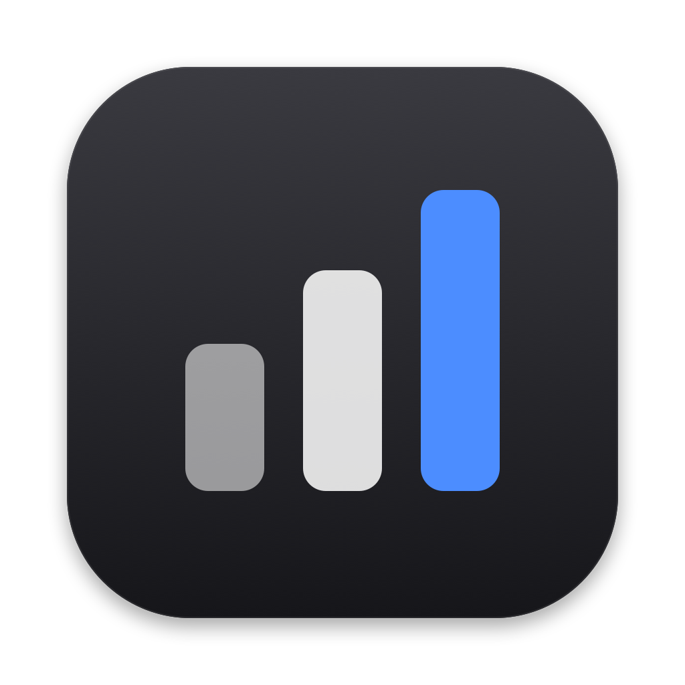
</p>

<h1 align="center">BulkBoard</h1>

<p align="center">
  A local-first Mac app for bulking: macros, meal plans, grocery lists, training, body measurements and progress, in one place. Built for athletes who want to add size without losing their game, dunk included.
</p>

<p align="center">
  <a href="https://github.com/XmanXay69/bulkboard/actions/workflows/ci.yml"></a>
  
  
  
  <a href="LICENSE"></a>
</p>

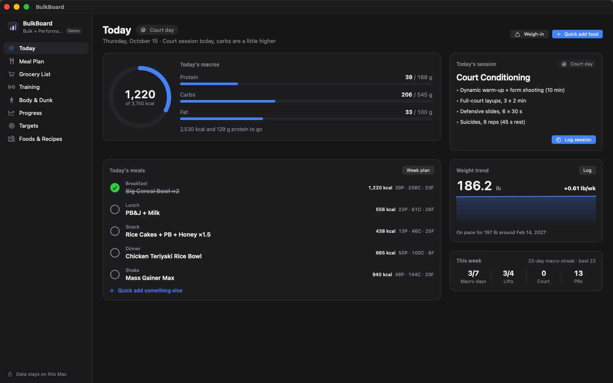

## What it does

1. **Sets your calorie and macro targets** from your stats and goal, and shows the math.
2. **Builds a weekly meal plan** that hits those targets, from a built-in food list or your own recipes.
3. **Generates the grocery list** from the plan, merged and grouped by aisle.
4. **Plans your training week**: a lifting split for a standard gym plus basketball/conditioning days.
5. **Reads your body**: tape measurements and an optional photo point out lagging muscles, then the plan gives them extra work.
6. **Works out what it takes to dunk** from your height, wingspan, reach and vertical, and adds jump training.
7. **Tracks progress**: bodyweight trend, lifts, PRs, adherence and streaks.

No account, no cloud, no analytics. Your data stays on your Mac.

## Features

### Targets that show their work
- Mifflin-St Jeor BMR × activity level for maintenance, then a surplus sized to your target rate of gain (default 0.5–1 lb/week).
- Warns when a goal date is unrealistic, caps the rate, and tells you when you'll actually get there.
- Protein from bodyweight (0.8–1 g/lb), fat as a share of calories (25–30%), carbs fill the rest.
- Separate targets for lift, court and rest days that average out to your weekly target. Override any of them.
- Five goal modes: Bulk, **Bulk + Performance** (default), Recomp, Cut, Maintain.

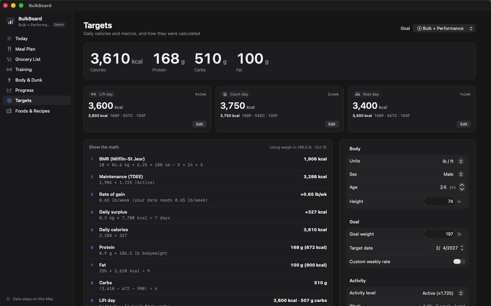

### Meal planner
- 7-day grid with breakfast, lunch, snacks, dinner and shakes; running totals per day against that day's target.
- **Auto-fill my week** picks meals and portions so each day lands on target. **Shuffle** re-rolls anything unlocked; **lock** meals you like.
- Click a slot to pick a meal, or drag from the meal library. Right-click for servings, swap, lock, or mark eaten.
- Respects allergies and dislikes. A **variety** setting goes from *Meal prep* (repeat a few meals, short grocery list) to *Mix it up*.
- 80 built-in foods, 44 meals, and **shaker-bottle-only shakes** (powders and liquids only, enforced by tests). An editable whey scoop is pre-seeded under *My foods*.

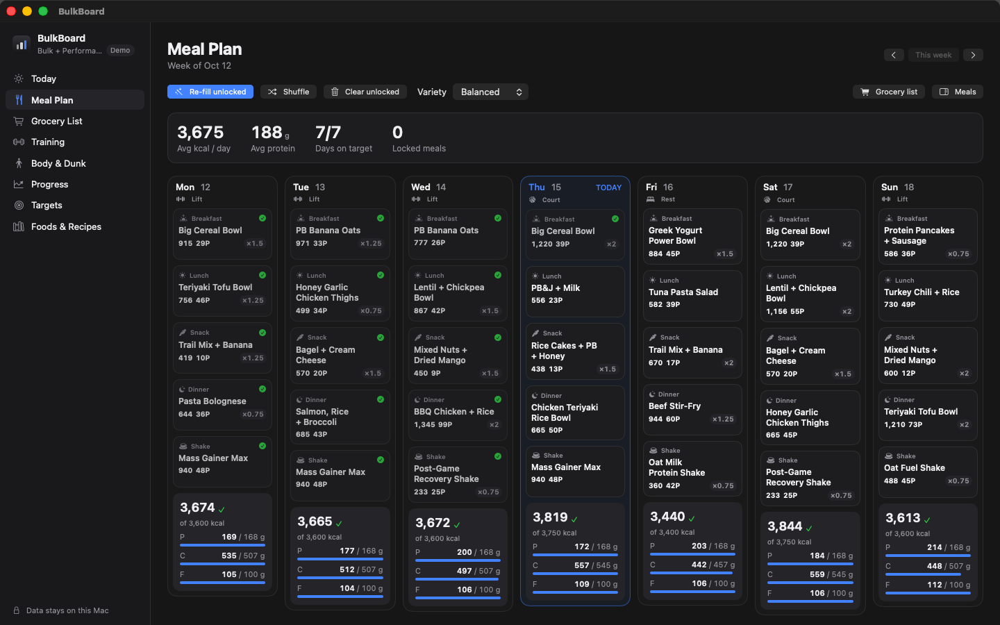

### Grocery list
- One click builds it from the week's plan. Quantities merge across meals with unit conversion and group by store section.
- Check-off mode, a phone-sized **pop-out window** for the store, manual items, copy or export as plain text.

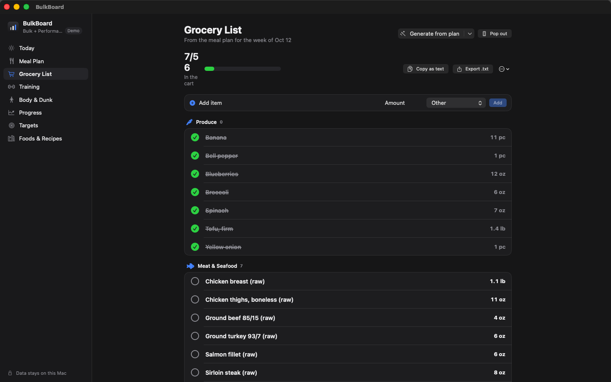

### Training
- Weekly plan for 0–6 lifting days plus court days, arranged so leg days don't land right before court days.
- Live logger with **previous performance inline**, **progressive overload suggestions** ("Last time 135 × 8 lb. Try 140 today."), a rest timer, and **automatic PR detection** (heaviest weight, best e1RM, rep PRs).
- Log basketball or conditioning sessions with duration and RPE; the load shows up next to lifting volume.
- 58-exercise library for barbells, dumbbells, machines and cables, plus your own custom exercises.

| This week | Logging a session |
|---|---|
| 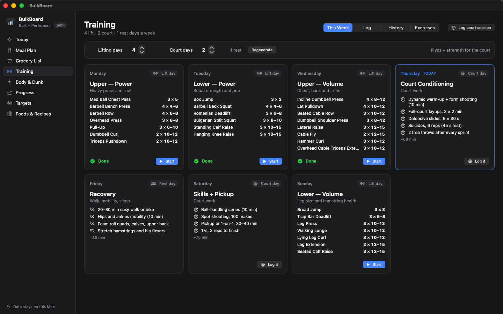 | 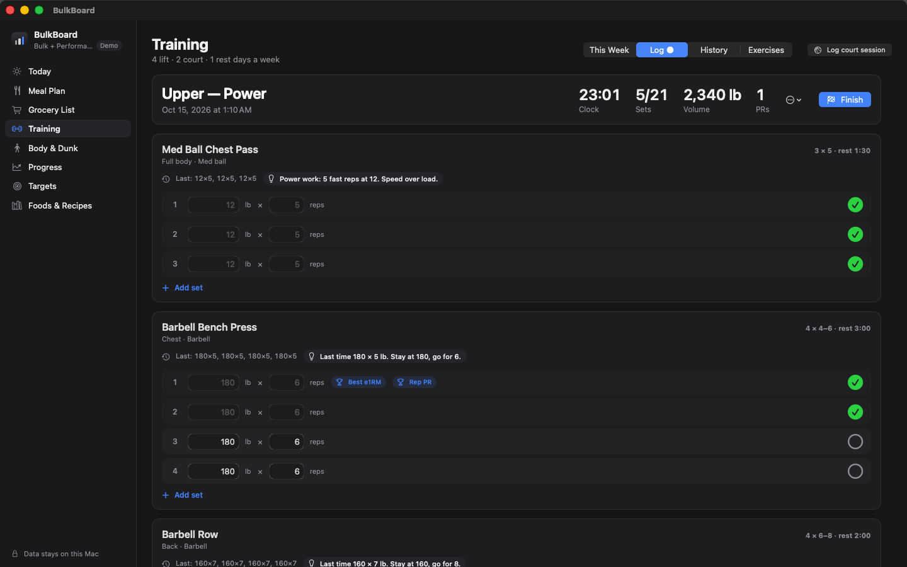 |

### Body & Dunk
- **Check-ins**: height, weight, wingspan, standing reach, wrist and tape measurements, body fat (or a Navy-method estimate), standing vertical and best running touch, plus an optional photo.
- **Proportions**: each part is compared with a classic target scaled to your frame (chest = 6.5 × wrist and fixed shares of that, shoulders ≈ 1.618 × waist for the V-taper). The weakest parts are flagged as focus areas. FFMI shows how much lean mass you have relative to your height.
- **AI photo review** (optional): a vision model running in Ollama on your Mac gives a second opinion on what looks behind. Nothing is uploaded.
- **Apply to my plan**: focus muscles get extra sets and an accessory on the days that train them, with an optional protein bump. (Food can't target one muscle; the extra training decides where growth shows up.)
- **Dunk**: estimates your standing reach from height and wingspan (fit to NBA combine data), works out the running jump a dunk needs, measures the gap against your numbers, and shows what each 10 lb of bulk costs in vertical at the same power (Sayers equation). One click adds depth jumps, trap-bar jumps, calf and ankle work, and approach jumps on court days, and can cap your gain rate at 0.5 lb/week.

| Physique | Dunk |
|---|---|
| 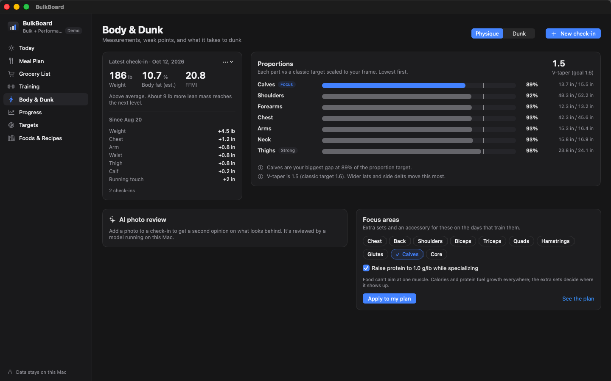 | 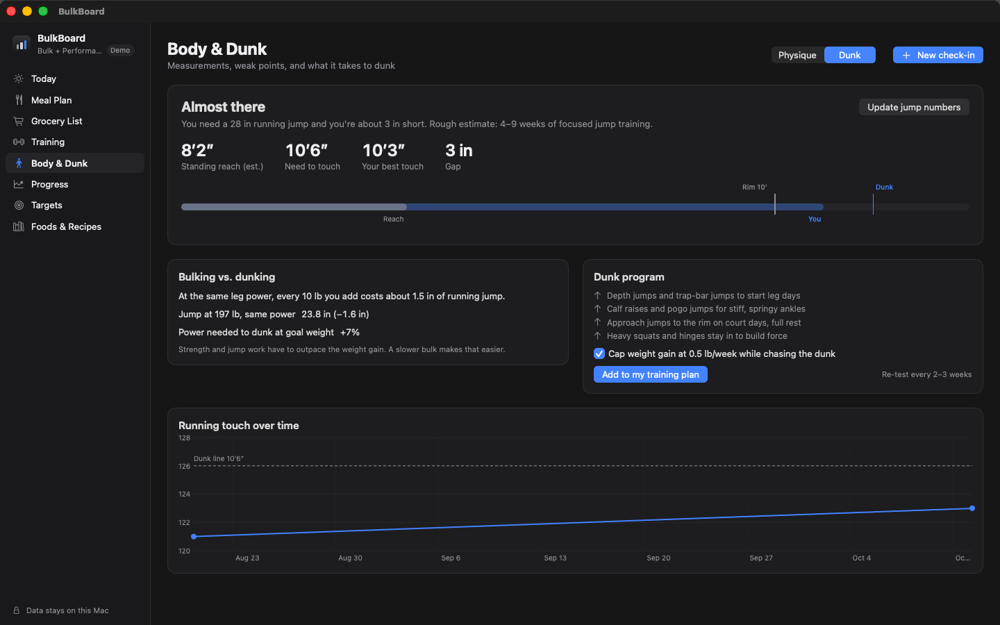 |

### Progress
- Bodyweight with a 7-day moving average and a projection toward your goal date.
- Estimated 1RM per lift, weekly lifting volume, court load, calorie and protein adherence.
- Macro streaks and a weekly summary (this week vs last).

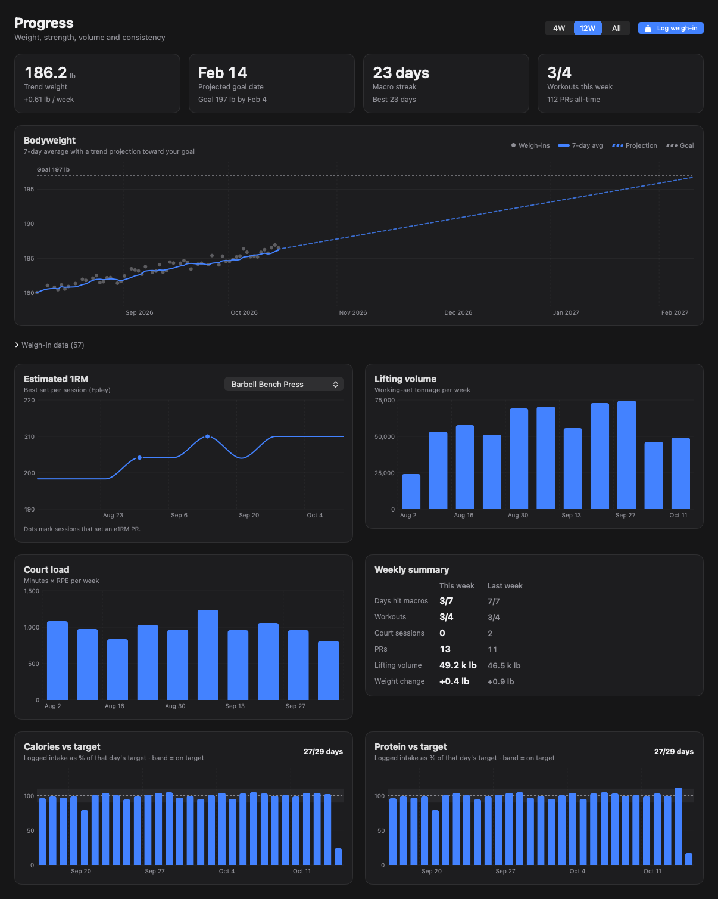

### Optional local AI
If [Ollama](https://ollama.com) is running on your Mac, BulkBoard adds meal ideas, macro estimates for anything you type, higher-protein swaps, and (with a vision model such as `llama3.2-vision`) photo reviews. It talks only to `127.0.0.1:11434`. No cloud APIs, no keys. AI numbers are labeled as estimates. Without Ollama, these controls stay hidden.

### Design
Neutral and quiet: system fonts, one accent color, native controls, light and dark mode (follows macOS by default).

| Welcome | Light mode |
|---|---|
| 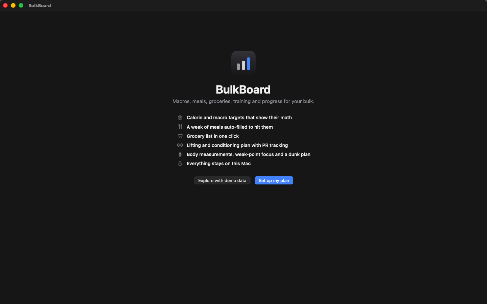 | 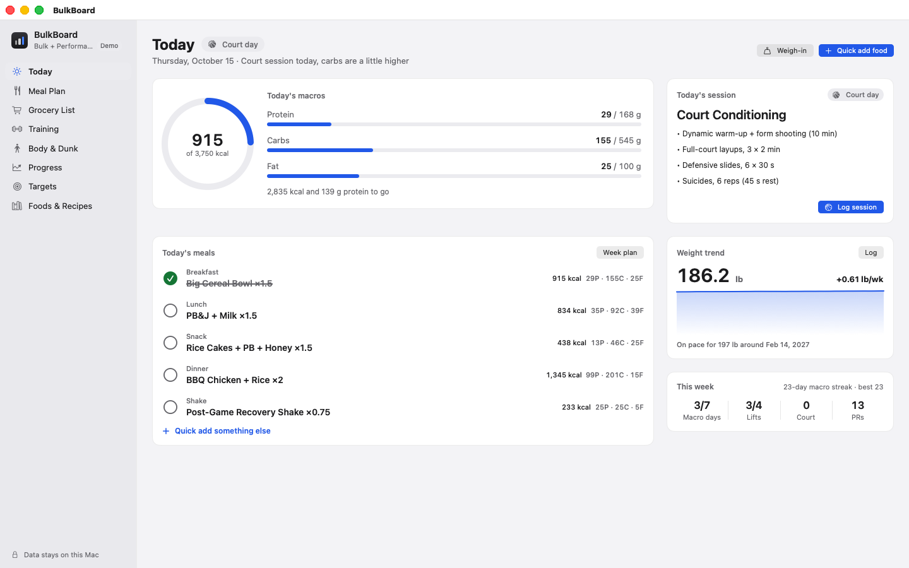 |

## Install

1. Download the zip from the [latest release](https://github.com/XmanXay69/bulkboard/releases/latest) and unzip it.
2. Drag **BulkBoard.app** to Applications.
3. The build is ad-hoc signed, not notarized, so macOS will block the first launch. Either:
   - open it once, then go to **System Settings → Privacy & Security** and click **Open Anyway**, or
   - run this once:

```bash
xattr -dr com.apple.quarantine /Applications/BulkBoard.app
```

Requires macOS 15 Sequoia or later, Apple silicon or Intel (universal build).

## Build from source

Requires Xcode 26 or later.

```bash
git clone https://github.com/XmanXay69/bulkboard.git
```

```bash
cd bulkboard && open BulkBoard.xcodeproj
```

Press ⌘R. The Xcode project is generated from `project.yml` with [XcodeGen](https://github.com/yonaskolb/XcodeGen) and committed, so you only need XcodeGen when you add or move files (`brew install xcodegen && xcodegen generate`).

Run all tests:

```bash
scripts/test.sh
```

To try it without entering your own stats, click **Explore with demo data** on the welcome screen. Demo records carry a Demo badge and can be wiped from Settings → Data.

## Keyboard shortcuts

| Shortcut | Action |
|---|---|
| ⌘1 – ⌘8 | Today, Meal Plan, Grocery, Training, Body & Dunk, Progress, Targets, Foods & Recipes |
| ⇧⌘F | Auto-fill the week |
| ⇧⌘R | Shuffle unlocked meals |
| ⇧⌘G | Build grocery list |
| ⌘[ / ⌘] / ⇧⌘T | Previous / next / this week |
| ⇧⌘W | Log weigh-in |
| ⇧⌘E | Quick add food |
| ⇧⌘L | Start today's workout |
| ⇧⌘B | Log court session |
| ⇧⌘A | Ask the coach (with Ollama) |
| ⇧⌘S | Export backup |
| ⇧⌘C | Copy grocery list as text |

## Your data

- Stored with SwiftData in `~/Library/Application Support/BulkBoard/`; progress photos in its `Photos` folder (downscaled, location metadata stripped).
- **Automatic daily backups** (last 14 kept) to `…/BulkBoard/Backups` or a folder you pick. Backups include measurements but not photos.
- **Export / import** a full JSON backup, and export CSVs for weigh-ins, lifts, court sessions and intake (File menu or Settings → Data).
- The only network connection BulkBoard ever makes is to Ollama on `127.0.0.1`, and only if you enable it.

## Tech stack

- **SwiftUI + SwiftData + Swift Charts**, Swift 6 strict concurrency, macOS 15+.
- **BulkCore**, a pure Swift package with no UI and no persistence, holds all the math: TDEE, gain-rate planning, macro splits, meal auto-fill, grocery merging, the split generator (with focus and dunk modes), PR detection, overload suggestions, proportions and FFMI, dunk math, trend/projection, streaks. It's covered by 109 unit tests (`swift test`).
- The app target maps SwiftData records to BulkCore value types. 38 app tests cover onboarding, planning, groceries, training, body check-ins, progress, demo data and backups against an in-memory store.
- Built-in foods, meals and exercises ship as JSON in `Packages/BulkCore/Sources/BulkCore/Resources`. Tests check every food's calories against its macros, every recipe's ingredients, and that every shake is shaker-safe.

```
BulkBoard/
├── Packages/BulkCore/        # calculation logic + seed data + tests (swift test)
├── BulkBoard/
│   ├── App/                  # app entry, root/sidebar, menu commands
│   ├── Models/               # SwiftData records, persistence, record ↔ core mapping
│   ├── Services/             # meals, grocery, training, body, progress, backup, photos, Ollama, demo data
│   ├── Features/             # Today, Meals, Grocery, Training, Body, Progress, Targets, Library, Settings, Onboarding
│   ├── Design/               # theme tokens, components, charts, toasts, app mark
│   └── Debug/                # launch-argument screenshot capture
├── BulkBoardTests/           # app-level tests (in-memory store)
├── scripts/                  # test, capture, screenshots, icon, release
└── project.yml               # XcodeGen spec
```

## Roadmap

- [ ] Side-by-side photo comparison between check-ins
- [ ] Barcode / label scanning via Continuity Camera
- [ ] iPhone companion for logging sets and groceries at the gym (opt-in sync)
- [ ] Plate calculator and warm-up set generator
- [ ] Deload weeks and periodization blocks
- [ ] Edit the generated split (swap exercises, reorder days)
- [ ] Apple Health export for weight and workouts
- [ ] Notarized builds

## Contributing

Issues and PRs are welcome; see [CONTRIBUTING.md](CONTRIBUTING.md). Adding foods or meals is a great first PR: edit the JSON and the tests tell you if anything's off.

## Disclaimer

BulkBoard does arithmetic on standard formulas and published estimates. Proportion targets are aesthetic yardsticks, not health standards, and dunk timelines are rough. It isn't medical or dietary advice.

## License

[MIT](LICENSE) © 2026 Xay
